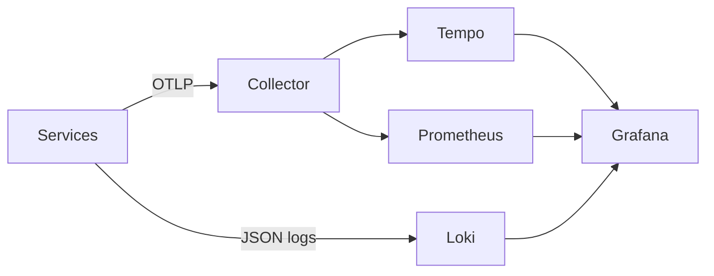

# otel-stack-lab
A reproducible OpenTelemetry laboratory with an OTLP collector, Prometheus, Tempo, and Grafana. It uses pinned images, bounded collector memory, batching, trace export, and Prometheus metric export.

```bash
docker compose up -d
./scripts/validate.sh
```

## Data flow

The sample checkout service emits OpenTelemetry spans over OTLP, JSON logs containing trace IDs, and Prometheus request/failure counters. Inject a reproducible incident with:

```sh
curl -i -X POST -H 'x-failure-mode: payment-timeout' localhost:8080/checkout
```

Use Tempo for the trace, Prometheus for the error counter, Loki for correlated JSON logs, and Grafana as the shared investigation surface.

The example SLO allows a 1% checkout error rate over five minutes. Prometheus evaluates the alert in `alerts.yml`; the response exercise is in `runbooks/checkout-errors.md`.
