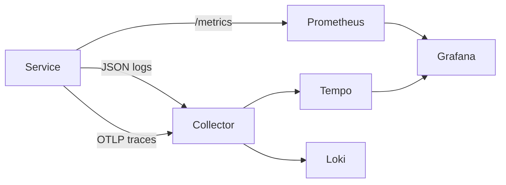

# otel-stack-lab

A local observability lab with OpenTelemetry Collector, Prometheus, Tempo, Loki, Grafana, and an instrumented Node service.

```sh
docker compose up --build
./scripts/validate.sh
```

The checkout service exports spans over OTLP, exposes Prometheus counters, and writes JSON logs containing the active trace ID. Inject a known failure with:

```sh
curl -i -X POST \
  -H 'x-failure-mode: payment-timeout' \
  localhost:8080/checkout
```

Prometheus evaluates a 99% checkout SLO from `alerts.yml`; `runbooks/checkout-errors.md` walks through the incident. Tempo stores traces. The collector tails the service's JSON log file and exports it to Loki. Grafana starts with all three data sources provisioned.


