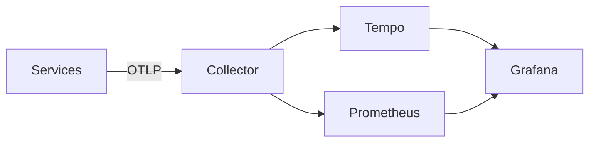

# otel-stack-lab
A reproducible OpenTelemetry laboratory with an OTLP collector, Prometheus, Tempo, and Grafana. It uses pinned images, bounded collector memory, batching, trace export, and Prometheus metric export.

```bash
docker compose up -d
./scripts/validate.sh
```

## Data flow


Next milestones add instrumented Rust/TypeScript services, Loki, provisioned dashboards, failure injection, SLOs, alerts, and an incident exercise.
